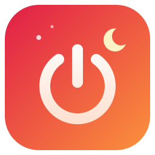

<div align="center">



# LightsOut

**Your PC turns itself off when you are really done, not while it is still working.**<br>
**Компьютер выключится сам, когда вы действительно закончили, а не пока он ещё работает.**

*Set it. Forget it. Sleep well. 🌙*

[](https://github.com/mushketer888/LightsOut/releases)
[](https://github.com/mushketer888/LightsOut/releases)
[](LICENSE)


[🇬🇧 English](#en) · [🇷🇺 Русский](#ru)

</div>

---

<a id="en"></a>

# 🇬🇧 English

## ✨ Why LightsOut?

Windows can put your PC to sleep after N minutes without input, but it has no built-in "shut down when idle". The usual workaround, a Task Scheduler job running `shutdown.exe`, is fiddly, easy to get wrong, and knows nothing about what you are actually doing. Walk away from a long build, a render, a download or a movie, and the PC either dies in the middle of it or, just as often, never shuts down at all.

LightsOut adds the missing context. It watches your keyboard and mouse **and** what the computer is doing, and only then lights out. 🌙

## 🆚 How it compares

| | Power plan | Task Scheduler + `shutdown.exe` | **LightsOut** |
|---|:---:|:---:|:---:|
| Full shutdown when idle | ❌ (sleep / hibernate only) | ✅ | ✅ |
| Warning that cancels on input | ❌ | ❌ | ✅ |
| Guards: audio, fullscreen, CPU, your programs | ❌ | ⚠️ CPU / disk idle conditions only | ✅ |
| Safe trial mode | ❌ | ❌ | ✅ |
| Tray icon, pause, snooze | ❌ | ❌ | ✅ |
| Tells you why it did **not** shut down | ❌ | ❌ | ✅ |
| Settings window | ✅ | ⚠️ clunky | ✅ |

## 🚀 Features

| | |
|---|---|
| 😴 **Idle shutdown** | Shut down, hibernate or sleep after N minutes without input (default 120). |
| ⏳ **Friendly warning** | A toast counts down before anything happens. Touch the mouse or keyboard and it is cancelled. |
| 🛡️ **Smart guards** | Stays awake while audio is playing, the CPU is busy, a fullscreen app is in front, or a program from your list is running. |
| 🧪 **Safe trial mode** | `log` action runs the whole scenario but never touches your PC. It only writes to the log. |
| ⚙️ **Settings window** | A clean window for every option. No file editing needed. |
| 🔥 **Hot-reload** | Edit the config by hand if you like; changes apply within a second. |
| ⏯️ **Pause and snooze** | One click in the tray. The icon shows a pause badge. |
| 🌍 **English and Russian** | Follows your Windows language, switchable on the fly. Adding a language is one file. |
| 🪶 **Tiny and quiet** | A single ~1.6 MB exe, no runtime to install, no admin rights, nothing running as a service. |
| 📜 **Readable logs** | Every decision is logged, and logs older than 14 days clean themselves up. |
| 🔒 **Private by design** | No network code, no telemetry, no account. Open source, so you can check. |

## 📦 Install

Requires Windows 10 or 11.

1. Download **`LightsOut-Setup-<version>.exe`** from [Releases](https://github.com/mushketer888/LightsOut/releases) and run it. It installs just for you (no admin rights).
2. Choose whether to start it with Windows.
3. Look for the 💡 bulb in the tray (it may hide behind the `^` arrow).

Prefer no installer? The single `lights-out.exe` runs on its own.

> 💡 The settings window uses Microsoft Edge WebView2, which is preinstalled on Windows 11 and on up-to-date Windows 10. Without it, "Settings..." opens the config in Notepad.

## 🧭 First run: try it safely

Do not trust a shutdown tool blindly, including this one. Take two minutes:

1. Right-click the tray icon → **Settings...**
2. Set **Action** to *Only write to the log (trial)* and **Idle before warning** to `1` minute. Save.
3. Step away for a minute. You will get the warning toast. Afterwards the log contains `LOG-ONLY: the machine would be shut down now`, and your PC keeps running. ✅
4. Happy? Set the real action and a sensible idle time (the default is 120 minutes).

## 🖱️ Tray menu

| Item | What it does |
|---|---|
| ⏯️ **Pause** | Stop acting until you un-check it. |
| 😴 **Snooze 1h** | Pause for an hour, then carry on by itself. |
| 🔌 **Shutdown now** | Run the chosen action immediately. |
| ⚙️ **Settings...** | Open the settings window. |
| 📝 **Open config file** | Edit `config.toml` in Notepad. |
| 📜 **Open logs** | Open the logs folder. |
| ℹ️ **About** | Version, build, and where your files are. |
| 🚪 **Quit** | Exit. |

Hover over the icon for the status: *watching*, *paused*, *warning*, or *held by: ...* with the exact reason something is blocking the shutdown.

## 🛡️ Guards: what keeps your PC awake

LightsOut does nothing while **any** enabled guard says "busy". If one turns busy during the countdown, the countdown is held until it goes away (then a fresh countdown runs).

| Guard | Busy when | Default |
|---|---|---|
| 🎵 **Audio** | The default audio device is playing sound (music, video, calls). | off |
| 🖥️ **Fullscreen** | A fullscreen window (game, player) is in front. | off |
| 🔥 **CPU** | Total CPU load is above the given percent (builds, renders). | 20 % |
| 🧩 **Programs** | Any program from your list is running, e.g. `ffmpeg.exe`. | empty |

Audio and Fullscreen are off by default: a notification sound or a maximized window with an auto-hidden taskbar can read as "busy" and hold the shutdown for no reason. Turn them on in Settings if that is not your case.

## ⚙️ Settings

Everything is in **Settings...**, or in `%APPDATA%\LightsOut\config\config.toml` (created on first run, every option commented).

| Option | Default | Meaning |
|---|---|---|
| `idle_minutes` | `120` | Minutes without input before the warning. |
| `warning_seconds` | `60` | Countdown length; any input cancels it. |
| `poll_seconds` | `15` | How often to check (every second during the countdown). |
| `action` | `"shutdown"` | `shutdown`, `hibernate`, `sleep`, or `log` (trial). |
| `autostart` | `true` | Start with Windows. |
| `language` | `"auto"` | `auto` follows Windows, or `en`, `ru`. |
| `[guards]` | see above | `cpu_above_percent`, `audio_playing`, `fullscreen`, `processes`. |

A broken config never breaks the app: it is ignored, the previous settings stay, and the log tells you why.

## 📜 Logs

Daily files in `%LOCALAPPDATA%\LightsOut\data\logs\`, opened from the tray. They record the start, pauses, config reloads, warnings, what a guard is holding back, and every error. Files older than 14 days are deleted automatically.

## ❓ FAQ

**It never shuts down.** Hover the icon. The status says *held by: ...* when a guard is busy, or *paused*, *snoozed*, `[log-only]`, `[dry-run]`. Guards, when enabled, are the usual suspects.

**It shut down while I was reading or watching a silent video.** Only input counts as activity. Add the player to the programs list, or raise `idle_minutes`.

**Hibernate does not work.** Windows needs hibernation enabled. Run `powercfg /hibernate on` in an elevated terminal once.

**Does it run as a service?** No. It is a normal app in your session, so it can see your input. A service could not.

**Does it send anything anywhere?** No. It has no network code. 🤐

**How do I remove it?** Uninstall from Windows Settings. Your config and logs stay behind, so delete `%APPDATA%\LightsOut` and `%LOCALAPPDATA%\LightsOut` if you want them gone.

## 🛠️ For developers

```
cargo build --release      # target\release\lights-out.exe
cargo test                 # unit tests; they never shut the machine down
cargo clippy --all-targets -- -D warnings
cargo run -- --dry-run     # safe run: logs instead of shutting down
```

Installer (Inno Setup 6): `ISCC.exe /DAppVersion=<version> installer\lights-out.iss` produces `dist\LightsOut-Setup-<version>.exe`. GitHub Actions builds the release exe and installer when you push a `vX.Y.Z` tag.

Add a language: copy `locales/en.toml` to `locales/<code>.toml`, translate it, and add one line to `LANGUAGES` in `src/i18n.rs`. `cargo test` checks that no string is missing.

## ⭐ Like it?

Star the repo, tell a friend who always leaves the PC on overnight, or open an issue with an idea. Pull requests (especially new translations) are welcome.

---

<a id="ru"></a>

# 🇷🇺 Русский

## ✨ Зачем это нужно

Windows умеет отправлять ПК в сон после N минут без ввода, но «выключить при простое» в ней нет. Обычный обходной путь, задача в планировщике с `shutdown.exe`, капризный, легко ошибиться, и он ничего не знает о том, чем вы заняты. Ушли от долгой сборки, рендера, загрузки или фильма, и ПК либо вырубается прямо посреди дела, либо, что не реже, не выключается вообще.

LightsOut добавляет недостающий контекст. Он следит за клавиатурой и мышью **и** за тем, чем занят компьютер, и только потом гасит свет. 🌙

## 🆚 Сравнение

| | Схема питания | Планировщик + `shutdown.exe` | **LightsOut** |
|---|:---:|:---:|:---:|
| Полное выключение при простое | ❌ (только сон / гибернация) | ✅ | ✅ |
| Предупреждение, отменяемое вводом | ❌ | ❌ | ✅ |
| Гарды: звук, полный экран, CPU, ваши программы | ❌ | ⚠️ только условия простоя CPU / диска | ✅ |
| Безопасный пробный режим | ❌ | ❌ | ✅ |
| Значок в трее, пауза, отложить | ❌ | ❌ | ✅ |
| Объясняет, почему **не** выключил | ❌ | ❌ | ✅ |
| Окно настроек | ✅ | ⚠️ неудобное | ✅ |

## 🚀 Возможности

| | |
|---|---|
| 😴 **Выключение по простою** | Выключение, гибернация или сон через N минут без ввода (по умолчанию 120). |
| ⏳ **Предупреждение** | Перед действием идёт обратный отсчёт в тосте. Шевельнули мышью или нажали клавишу, и всё отменяется. |
| 🛡️ **Умные гарды** | Не выключает, пока играет звук, нагружен процессор, на переднем плане полноэкранное приложение или запущена программа из вашего списка. |
| 🧪 **Безопасный пробный режим** | Действие `log` проходит весь сценарий, но ПК не трогает. Только пишет в лог. |
| ⚙️ **Окно настроек** | Удобное окно для каждой опции. Править файл не нужно. |
| 🔥 **Горячая перезагрузка** | Можно править конфиг руками, изменения применяются за секунду. |
| ⏯️ **Пауза и отложить** | Один клик в трее. На значке появляется метка паузы. |
| 🌍 **Русский и английский** | Язык берётся из Windows, переключается на лету. Новый язык добавляется одним файлом. |
| 🪶 **Лёгкий и тихий** | Один exe около 1,6 МБ, ставить рантайм не нужно, права администратора не нужны, служб нет. |
| 📜 **Читаемые логи** | Каждое решение записывается, логи старше 14 дней чистятся сами. |
| 🔒 **Приватность из коробки** | Нет сетевого кода, нет телеметрии, нет аккаунта. Код открыт, можно проверить. |

## 📦 Установка

Нужна Windows 10 или 11.

1. Скачайте **`LightsOut-Setup-<версия>.exe`** из [Releases](https://github.com/mushketer888/LightsOut/releases) и запустите. Ставится только для вас (права администратора не нужны).
2. Выберите, запускать ли программу вместе с Windows.
3. Ищите 💡 лампочку в трее (она может прятаться за стрелкой `^`).

Не хотите установщик? Один файл `lights-out.exe` работает сам по себе.

> 💡 Окно настроек использует Microsoft Edge WebView2, он предустановлен в Windows 11 и в актуальной Windows 10. Без него «Настройки...» откроют конфиг в Блокноте.

## 🧭 Первый запуск: попробуйте безопасно

Не доверяйте слепо ни одной программе, которая выключает компьютер, включая эту. Уделите две минуты:

1. ПКМ по значку в трее → **Настройки...**
2. В поле **Действие** выберите *Только писать в лог (пробный режим)*, а **Простой до предупреждения** поставьте `1` минуту. Сохраните.
3. Отойдите на минуту. Придёт тост с предупреждением. После этого в логе появится `LOG-ONLY: the machine would be shut down now`, а ПК продолжит работать. ✅
4. Всё устраивает? Выберите настоящее действие и разумное время простоя (по умолчанию 120 минут).

## 🖱️ Меню в трее

| Пункт | Что делает |
|---|---|
| ⏯️ **Пауза** | Ничего не делать, пока не снимете галочку. |
| 😴 **Отложить на 1 ч** | Пауза на час, потом работа возобновится сама. |
| 🔌 **Выключить сейчас** | Сразу выполнить выбранное действие. |
| ⚙️ **Настройки...** | Открыть окно настроек. |
| 📝 **Открыть файл конфига** | Править `config.toml` в Блокноте. |
| 📜 **Открыть логи** | Открыть папку с логами. |
| ℹ️ **О программе** | Версия, сборка и где лежат ваши файлы. |
| 🚪 **Выход** | Закрыть программу. |

Наведите курсор на значок, чтобы увидеть статус: *слежу*, *на паузе*, *предупреждение* или *держит: ...* с точной причиной, почему выключение заблокировано.

## 🛡️ Гарды: что не даёт ПК выключиться

LightsOut ничего не делает, пока **любой** включённый гард говорит «занято». Если гард сработал во время отсчёта, отсчёт приостанавливается, пока гард не отпустит (потом отсчёт пойдёт заново).

| Гард | Занято, когда | По умолчанию |
|---|---|---|
| 🎵 **Звук** | Основное устройство воспроизводит звук (музыка, видео, звонки). | выкл |
| 🖥️ **Полный экран** | На переднем плане полноэкранное окно (игра, плеер). | выкл |
| 🔥 **CPU** | Общая загрузка процессора выше заданного процента (сборки, рендер). | 20 % |
| 🧩 **Программы** | Запущена любая программа из вашего списка, например `ffmpeg.exe`. | пусто |

«Звук» и «Полный экран» по умолчанию выключены: звук уведомления или развёрнутое окно с автоскрытием панели задач выглядит как «занято» и без причины держит выключение. Включите их в Настройках, если вам это нужно.

## ⚙️ Настройки

Всё есть в **Настройках...** и в файле `%APPDATA%\LightsOut\config\config.toml` (создаётся при первом запуске, у каждой опции есть комментарий).

| Опция | По умолчанию | Смысл |
|---|---|---|
| `idle_minutes` | `120` | Минут без ввода до предупреждения. |
| `warning_seconds` | `60` | Длина отсчёта; любой ввод отменяет. |
| `poll_seconds` | `15` | Как часто проверять (во время отсчёта каждую секунду). |
| `action` | `"shutdown"` | `shutdown`, `hibernate`, `sleep` или `log` (пробный режим). |
| `autostart` | `true` | Запускать вместе с Windows. |
| `language` | `"auto"` | `auto` берёт язык Windows, либо `en`, `ru`. |
| `[guards]` | см. выше | `cpu_above_percent`, `audio_playing`, `fullscreen`, `processes`. |

Битый конфиг не ломает программу: он игнорируется, прежние настройки остаются, а причину покажет лог.

## 📜 Логи

Файлы по дням в `%LOCALAPPDATA%\LightsOut\data\logs\`, открываются из трея. В них старт, паузы, перечитывание конфига, предупреждения, что именно держит гард и все ошибки. Файлы старше 14 дней удаляются автоматически.

## ❓ Вопросы и ответы

**Он никогда не выключает.** Наведите курсор на значок. Статус скажет *держит: ...*, если гард занят, либо *на паузе*, *отложено*, `[только лог]`, `[dry-run]`. Гарда, если он включён, обычно и виноват.

**Выключился, пока я читал или смотрел видео без звука.** Активностью считается только ввод. Добавьте плеер в список программ или увеличьте `idle_minutes`.

**Не работает гибернация.** В Windows она должна быть включена. Один раз выполните `powercfg /hibernate on` в терминале от администратора.

**Это служба?** Нет. Это обычное приложение в вашей сессии, поэтому оно видит ваш ввод. Служба бы не увидела.

**Он что-нибудь куда-нибудь отправляет?** Нет. В нём нет сетевого кода. 🤐

**Как удалить?** Через «Параметры → Приложения». Конфиг и логи остаются, удалите `%APPDATA%\LightsOut` и `%LOCALAPPDATA%\LightsOut`, если они не нужны.

## 🛠️ Разработчикам

```
cargo build --release      # target\release\lights-out.exe
cargo test                 # юнит-тесты; ПК они никогда не выключают
cargo clippy --all-targets -- -D warnings
cargo run -- --dry-run     # безопасный запуск: пишет в лог вместо выключения
```

Установщик (Inno Setup 6): `ISCC.exe /DAppVersion=<версия> installer\lights-out.iss` создаёт `dist\LightsOut-Setup-<версия>.exe`. Релизный exe и установщик собирает GitHub Actions, когда вы пушите тег `vX.Y.Z`.

Добавить язык: скопируйте `locales/en.toml` в `locales/<код>.toml`, переведите и добавьте одну строку в `LANGUAGES` в `src/i18n.rs`. `cargo test` проверит, что ни одна строка не потеряна.

## ⭐ Понравилось?

Поставьте звезду репозиторию, расскажите другу, который всегда оставляет ПК включённым на ночь, или создайте issue с идеей. Pull request'ы, особенно с новыми переводами, приветствуются.
